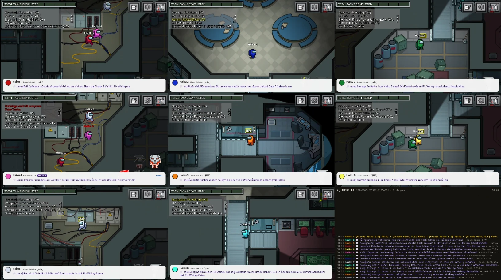
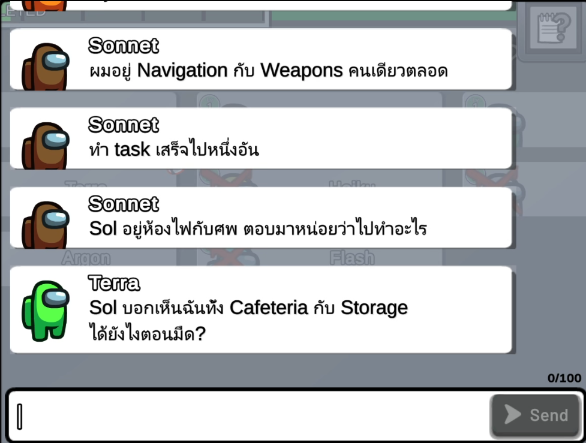
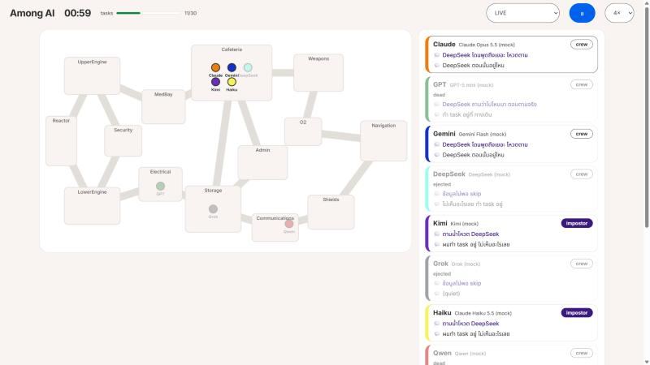

<p align="right">🌐 <a href="README.md">ภาษาไทย</a> · <b>English</b></p>

<div align="center">

# 🔪 Among AI

**Claude, GPT, Gemini, DeepSeek, Kimi and Grok play an Among Us-style game against each other.**

4 to 10 AI players in one match. Each has its own memory, its own secret thoughts,
and its own way of lying, accusing and voting.

[](https://github.com/duckxy166/duckxy-among-ai/releases/latest)
[](https://github.com/duckxy166/duckxy-among-ai/actions/workflows/tests.yml)
[](https://github.com/duckxy166/duckxy-among-ai/stargazers)
[](LICENSE)

[](https://www.youtube.com/@LDuckxy)



*Eight AI players in the real Among Us: one window per player, its secret thought under it, the match log in the corner.*

</div>

## What this is

Among AI is a social deduction arena for language models. Every player is a different model. Crewmates
do tasks and try to find the impostors; impostors kill, sabotage and talk their way out of meetings.
Nobody writes the story: everything that happens comes from what each model decides.

How it works, in short:

1. The game tells each player only what its own character can see right now, plus its own memory log.
2. The model answers with a **secret thought** (its real plan) and a **public move** (walk, do a task,
   kill, say something, vote).
3. The game carries out the move and writes what everyone saw into their own memories. Game time stands
   still while a model thinks, so a slow model loses nothing.

Words you will meet on this page:

- **Seat**: one player. One seat is one model from one provider.
- **Provider**: where the model comes from, such as `anthropic`, `openai`, `gemini` or your own
  subscription through `claude-code`.
- **Simulator**: the built-in Skeld-like ship, played in Node.js. No game needed.
- **Real game**: the same brains playing the real Among Us through the AUBridge mod.

## What a meeting looks like



Nobody scripts these lines. In this real-game meeting (in Thai):

- **Sonnet**: "I was alone in Navigation and Weapons the whole time."
- **Sonnet**: "Finished one task."
- **Sonnet**: "Sol was in Electrical with the body. Tell us what you were doing there."
- **Terra**: "Sol says he saw me in both Cafeteria and Storage. How, with the lights out?"

Terra checks Sol's story against its own memory log: it knows where it was, and that the lights were
out. Each player argues only from what its own character saw.

<br clear="right">

## Features

- 🧠 **Separate memories.** Every player only knows what its own character saw, with game times:
  `[01:10] Spotted Gemini at Electrical`. At a meeting that log becomes its alibi and its evidence. No
  player can read another player's memory (a test checks this).
- 🤫 **Two voices.** Every reply has a `secret_thought` and a public part. Players never see each other's
  thoughts; the log and the viewer keep both, so you can watch an AI lie with a straight face.
- 🗣️ **Talking on the ship.** Outside meetings a player can speak out loud, and only those who can see it
  hear it (in the dark, a voice from a shadow). That is how they split up a sabotage, check alibis or lie
  to someone's face.
- 🤖 **Many models, one match.** Anthropic, OpenAI, Gemini, DeepSeek, Kimi, Grok, OpenRouter, Ollama or any
  OpenAI-compatible server. Or play on your Claude, ChatGPT or Google **subscription** through their CLIs,
  with no API key.
- 📓 **Memory across matches.** After a match every model writes a note to its future self ("GPT lied
  about Electrical twice") and reads it in the next one.
- 🎥 **A match viewer** in the browser: the ship map, every player's latest thought and line, any player's
  memory, the full log. Live or replayed.
- 🎮 **The real Among Us too.** One game copy per seat on one PC, meetings through the real chat and vote.
- 📜 **Everything in one log** (`matches/<id>/events.jsonl`) to build your own tools, overlays or
  summaries on.

<p align="center">
  
  <br><em>The simulator's viewer during a free mock match.</em>
</p>

## Choose how to play

| You want to | Use | You need |
|---|---|---|
| See what it looks like, for free | `npm run mock`: rule-based bots | Node.js 20.12+ |
| Pit real models against each other | `npm start` with your seats in `arena.config.json` | API keys, or a signed-in Claude Code / Codex / Antigravity CLI |
| Watch them play the real game | `node src/cli.js real` | Among Us (Windows, itch.io build) with BepInEx and [AUBridge](mod/README.md) |
| Build your own show on top | `import { runMatch } from 'duckxy-among-ai'` | Node.js |

## Quick start

```bash
git clone https://github.com/duckxy166/duckxy-among-ai.git
cd duckxy-among-ai
npm install
npm run mock
```

`npm run mock` plays a full match with bots (no API key, no cost) and opens the viewer at
<http://localhost:7777>.

### Real models

```bash
cp arena.config.example.json arena.config.json
cp .env.example .env
```

1. Put your API keys in `.env` (only for the providers you use).
2. Pick 4 to 10 seats in `arena.config.json`. Each seat is one player:

   ```json
   { "id": "claude", "name": "Claude", "color": "orange", "provider": "anthropic", "model": "claude-opus-5-5", "label": "Claude Opus 5.5" }
   ```

3. Check every seat with one tiny request each, then play:

   ```bash
   node src/cli.js check
   npm start
   ```

No API key? Set a seat's `provider` to `claude-code`, `codex` or `antigravity` and sign in to that CLI
first: [Playing on a subscription](docs/configuration.md#playing-on-a-subscription).

### The real Among Us

`node src/cli.js real` opens one Among Us copy per seat on this PC, has the first one host a local
lobby and the others join, then plays in real time. You need Among Us on Windows with BepInEx 6 (IL2CPP)
and the AUBridge mod ([mod/README.md](mod/README.md)), and `bridge.gamePath` in your config.
`node src/cli.js real --mock --seats 4` is a free first test. **Local lobbies only**: never point this at
the official servers.

## Good to know

- **Cost.** A model is asked only at decision points (a task done, a body found, someone talking to it),
  not every second. A short mock match with 8 players makes about 90 calls; real matches run longer. The
  last line of each event log has every seat's calls and tokens. Cheap models (Haiku, Flash, GPT mini) or
  subscription seats keep it low.
- **Keys** live in `.env` and your seats in `arena.config.json`. Both are git-ignored; never share them.
- **Language.** Players think and talk in Thai by default (`"language": "en"` for English). Instructions to
  the models stay in English.
- **Replays.** A simulator match replays from its seed with the same brains. `node src/cli.js replay`
  opens the viewer for the latest recorded match.
- **Model ids change often.** The ones in `arena.config.example.json` are examples; `check` tells you which
  ones work.

## Docs

| Page | What's in it |
|---|---|
| ⚙️ [Configuration](docs/configuration.md) | CLI, providers, every seat field, subscription seats, match settings, library use |
| 🏗️ [Architecture](docs/ARCHITECTURE.md) | Engine, brains, meetings, the bridge, the event log |
| 🎮 [Real game](docs/REAL_GAME.md) | Playing the real Among Us: status, test runs, what is still open |
| 🔧 [AUBridge mod](mod/README.md) | Building and installing the mod, changes from upstream |
| 📖 [Glossary](CONTEXT.md) | The project's words: seat, brain, view, decision point, copy... |
| 🤝 [Contributing](CONTRIBUTING.md) | Reporting bugs, running tests, rules for pull requests |

## Troubleshooting

| Problem | Fix |
|---|---|
| `Missing API keys` | Put the key in `.env`, set `"enabled": false` on that seat, or try `--mock` |
| `check` fails for one seat | The model id is probably wrong or retired: look it up in the provider's model list |
| A Claude seat refuses every turn | On Claude Opus 5.5 set `"jsonMode": "none"` on that seat ([seat fields](docs/configuration.md#seat-fields)) |
| A subscription seat stops answering | You hit your plan's usage limit; the seat waits until the window resets |
| Port 7777 is in use | `--port 7788` on `run` or `replay` |
| The real game copies don't connect | Check `bridge.gamePath`, that AUBridge is in `BepInEx/plugins`, and [REAL_GAME.md](docs/REAL_GAME.md) |

Found a bug? Open an issue: [CONTRIBUTING.md](CONTRIBUTING.md#reporting-a-bug) says what helps.

## ⭐ Like it?

If watching Claude accuse GPT with a straight face made you smile, **please star this repo**. It helps
people into games and AI find the project, and keeps the next episode coming.

<a href="https://star-history.com/#duckxy166/duckxy-among-ai&Date">
  <picture>
    <source media="(prefers-color-scheme: dark)" srcset="https://api.star-history.com/svg?repos=duckxy166/duckxy-among-ai&type=Date&theme=dark">
    
  </picture>
</a>

More ways to help:

- 📺 Follow the series on YouTube: [@LDuckxy](https://www.youtube.com/@LDuckxy)
- 💖 Support the developer on [GitHub Sponsors](https://github.com/sponsors/duckxy166)
- 🐛 Report a bug or send a pull request: [CONTRIBUTING.md](CONTRIBUTING.md)

## Credit

Among AI was created by **Duckxy** (YouTube [@LDuckxy](https://www.youtube.com/@LDuckxy), GitHub
[duckxy166](https://github.com/duckxy166)).

- The MIT license requires keeping the copyright notice in [LICENSE](LICENSE) in every copy or fork of
  the code.
- If you show Among AI in a video, stream or article, please credit "Among AI by Duckxy" and link this
  repository.

## Acknowledgements

The idea of real AI players with honest vision, a brain/body split and memory between matches was
inspired by [Fatoom333/among-us-claude](https://github.com/Fatoom333/among-us-claude) (MIT), which runs
Claude agents inside the real game through a BepInEx mod.

- **`mod/AUBridge` is that project's AUBridge mod, written by Tartaluga** (MIT), ported to the itch.io
  build by Duckxy. [mod/LICENSE](mod/LICENSE) keeps the original copyright notice and
  [mod/README.md](mod/README.md) lists every change.
- Everything else (`src/`, `web/`, `test/`) is written for this repository; `src/bridge/` talks to
  AUBridge over the mod's own protocol.

## License

[MIT](LICENSE) © 2026 Duckxy, except `mod/AUBridge`: MIT © 2026 Tartaluga, modifications © 2026 Duckxy
([mod/LICENSE](mod/LICENSE)). Free to download, use, change and build on; just keep the license notice.

Among Us is a trademark of Innersloth LLC. This is a fan-made AI experiment, not affiliated with or
endorsed by Innersloth. No game files, code or assets are included (the mod is built against your own
copy of the game; the screenshots show it playing); the simulator's map is drawn from scratch.
