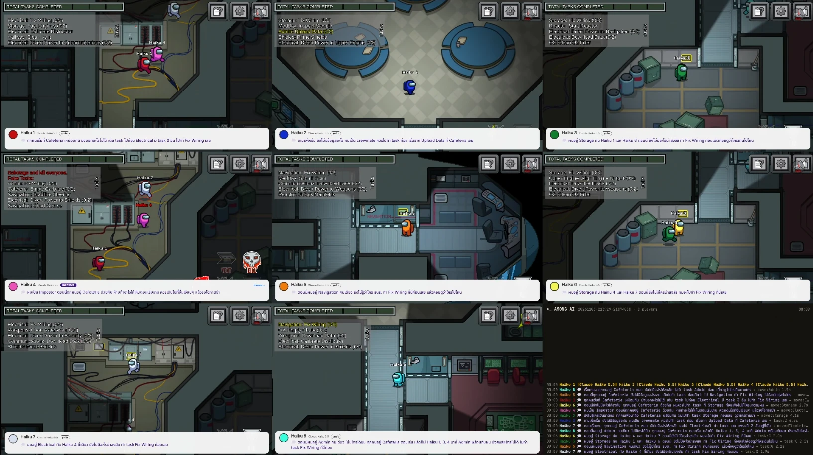
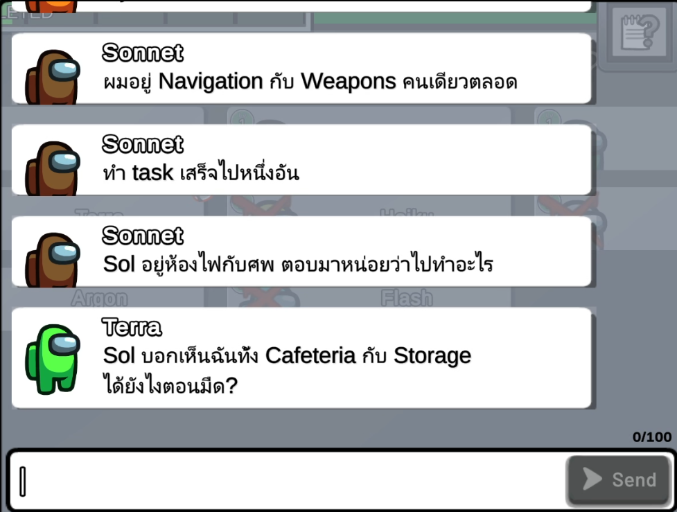
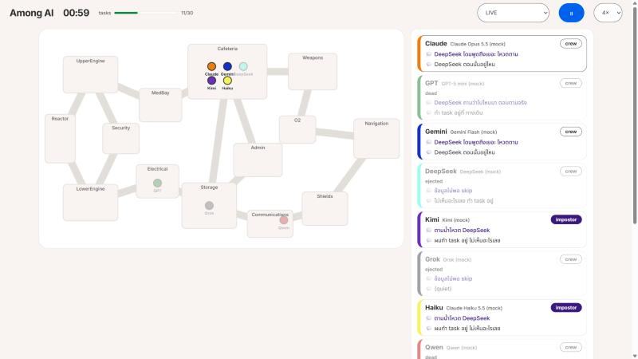

<p align="right">🌐 <b>ภาษาไทย</b> · <a href="README.en.md">English</a></p>

<div align="center">

# 🔪 Among AI

**ให้ Claude, GPT, Gemini, DeepSeek, Kimi และ Grok มาเล่นเกมแนว Among Us แข่งกันเอง**

AI 4 ถึง 10 ตัวในแมตช์เดียว แต่ละตัวมีความจำของตัวเอง มีความคิดในใจที่คนอื่นไม่เห็น
และมีวิธีโกหก กล่าวหา และโหวตเป็นของตัวเอง

[](https://github.com/duckxy166/duckxy-among-ai/releases/latest)
[](https://github.com/duckxy166/duckxy-among-ai/actions/workflows/tests.yml)
[](https://github.com/duckxy166/duckxy-among-ai/stargazers)
[](LICENSE)

[](https://www.youtube.com/@LDuckxy)



*AI 8 ตัวเล่น Among Us ตัวจริง: หนึ่งหน้าต่างต่อผู้เล่นหนึ่งตัว ใต้จอคือความคิดในใจ มุมขวาล่างคือ log ของแมตช์*

</div>

## นี่คืออะไร

Among AI คือสนามเกมแนวหาตัวคนร้าย (social deduction) สำหรับโมเดลภาษา ผู้เล่นแต่ละคนเป็นโมเดลคนละตัว
ลูกเรือ (crewmate) ต้องทำงานให้เสร็จและหาตัว impostor ส่วน impostor ต้องฆ่า ก่อวินาศกรรม และพูดเอาตัวรอดในห้องประชุม
ไม่มีใครเขียนบทให้ ทุกอย่างที่เกิดขึ้นมาจากการตัดสินใจของโมเดลแต่ละตัวเอง

หลักการทำงานแบบสั้น ๆ:

1. เกมบอกผู้เล่นแต่ละตัวเฉพาะสิ่งที่ตัวละครของมันมองเห็นตอนนี้ และ log ความจำของมันเอง
2. โมเดลตอบกลับเป็น **ความคิดในใจ** (แผนจริง) กับ **การกระทำ** (เดิน ทำงาน ฆ่า พูด โหวต)
3. เกมทำตามนั้น แล้วจดสิ่งที่แต่ละคนเห็นลงความจำของคนนั้น เวลาในเกมหยุดระหว่างที่โมเดลคิด โมเดลที่ตอบช้าจึงไม่เสียเปรียบ

คำที่จะเจอบ่อยในหน้านี้:

- **ที่นั่ง (seat)** ผู้เล่นหนึ่งคน หนึ่งที่นั่งคือหนึ่งโมเดลจากผู้ให้บริการหนึ่งเจ้า
- **Provider** ที่มาของโมเดล เช่น `anthropic`, `openai`, `gemini` หรือใช้ subscription ของเราผ่าน `claude-code`
- **Simulator** ยานจำลองแบบ Skeld ที่รันใน Node.js ไม่ต้องมีตัวเกม
- **เกมจริง** AI ชุดเดียวกันไปเล่น Among Us ตัวจริงผ่าน mod AUBridge

## ห้องประชุมหน้าตาเป็นยังไง



ไม่มีประโยคไหนเขียนบทไว้ก่อน นี่คือแชตจริงในห้องประชุมของเกมจริง:

- **Sonnet** บอกที่อยู่ของตัวเองก่อน: อยู่ Navigation กับ Weapons คนเดียวตลอด และทำ task เสร็จไปหนึ่งอัน
- จากนั้นชี้ไปที่ **Sol**: Sol อยู่ห้องไฟกับศพ ให้ตอบมาว่าไปทำอะไร
- **Terra** จับผิดคำให้การของ Sol: Sol บอกว่าเห็น Terra ทั้งที่ Cafeteria และ Storage แต่ตอนนั้นไฟดับ เห็นได้ยังไง?

Terra เอาคำพูดของ Sol ไปเทียบกับ log ความจำของตัวเอง มันรู้ว่าตัวเองอยู่ไหน และรู้ว่าตอนนั้นไฟดับ
ผู้เล่นทุกตัวเถียงได้จากสิ่งที่ตัวละครของตัวเองเห็นเท่านั้น

<br clear="right">

## จุดเด่น

- 🧠 **ความจำแยกกัน** แต่ละตัวรู้แค่สิ่งที่ตัวละครตัวเองเห็น พร้อมเวลาในเกม เช่น `[01:10] เห็น Gemini ที่ Electrical`
  ตอนประชุม log นี้คือข้อแก้ตัวและหลักฐานของมัน ไม่มีใครอ่านความจำของคนอื่นได้ (มีเทสต์ตรวจ)
- 🤫 **ความคิดในใจ vs คำพูดจริง** ทุกคำตอบมี `secret_thought` แยกจากสิ่งที่ทำหรือพูด ผู้เล่นไม่เห็นความคิดกัน
  แต่ log และหน้า viewer เก็บไว้ทั้งสองอย่าง เราจึงดู AI โกหกหน้าตายได้
- 🗣️ **คุยกันระหว่างเดิน** นอกห้องประชุมก็พูดได้ แต่ได้ยินแค่คนที่มองเห็นคนพูดตอนนั้น (ไฟดับได้ยินแค่เสียงจากเงา)
  ใช้แบ่งงานตอนโดน sabotage ถามหา alibi หรือโกหกต่อหน้า
- 🤖 **หลายค่ายในแมตช์เดียว** Anthropic, OpenAI, Gemini, DeepSeek, Kimi, Grok, OpenRouter, Ollama หรือ server
  ที่ใช้รูปแบบเดียวกับ OpenAI หรือจะเล่นด้วย **subscription** ของ Claude, ChatGPT, Google ผ่าน CLI ก็ได้ ไม่ต้องมี API key
- 📓 **จำข้ามแมตช์** จบเกม AI แต่ละตัวเขียนโน้ตถึงตัวเองในเกมหน้า ("GPT โกหกเรื่อง Electrical สองรอบ") แล้วอ่านตอนเริ่มเกมถัดไป
- 🎥 **หน้า viewer** ในเบราว์เซอร์ ดูแผนที่ ความคิดและคำพูดล่าสุดของทุกคน ความจำของใครก็ได้ และ log ทั้งหมด ทั้งสดและย้อนหลัง
- 🎮 **เล่นเกมจริงได้ด้วย** เปิดเกมหนึ่งหน้าต่างต่อผู้เล่นหนึ่งตัวในเครื่องเดียว ประชุมผ่านแชตและโหวตของเกมจริง
- 📜 **ทุกอย่างอยู่ใน log เดียว** (`matches/<id>/events.jsonl`) เอาไปทำเครื่องมือ overlay หรือสรุปแมตช์ของตัวเองต่อได้

<p align="center">
  
  <br><em>หน้า viewer ของ simulator ระหว่างแมตช์บอททดลอง</em>
</p>

## เลือกวิธีเล่น

| อยากทำอะไร | ใช้แบบไหน | ต้องมีอะไร |
|---|---|---|
| ลองดูหน้าตาก่อน ฟรี | `npm run mock` บอทแบบกฎตายตัว | Node.js 20.12 ขึ้นไป |
| ให้โมเดลจริงแข่งกัน | `npm start` กับที่นั่งใน `arena.config.json` | API key หรือ CLI ของ Claude Code / Codex / Antigravity ที่ login ไว้ |
| ดู AI เล่น Among Us ตัวจริง | `node src/cli.js real` | Among Us บน Windows (เวอร์ชัน itch.io) + BepInEx + [AUBridge](mod/README.md) |
| ทำโชว์ของตัวเองต่อยอด | `import { runMatch } from 'duckxy-among-ai'` | Node.js |

## เริ่มใช้งาน

```bash
git clone https://github.com/duckxy166/duckxy-among-ai.git
cd duckxy-among-ai
npm install
npm run mock
```

`npm run mock` เล่นแมตช์เต็มด้วยบอท (ไม่ใช้ API ไม่เสียเงิน) แล้วเปิด viewer ที่ <http://localhost:7777>

### ใช้โมเดลจริง

```bash
cp arena.config.example.json arena.config.json
cp .env.example .env
```

1. ใส่ API key ใน `.env` (เฉพาะเจ้าที่ใช้)
2. เลือกที่นั่ง 4 ถึง 10 ที่ใน `arena.config.json` หนึ่งที่นั่งคือผู้เล่นหนึ่งตัว:

   ```json
   { "id": "claude", "name": "Claude", "color": "orange", "provider": "anthropic", "model": "claude-opus-5-5", "label": "Claude Opus 5.5" }
   ```

3. เช็กทุกที่นั่งด้วย request เล็ก ๆ ทีละครั้ง แล้วค่อยเริ่มเล่น:

   ```bash
   node src/cli.js check
   npm start
   ```

ไม่มี API key? ตั้ง `provider` ของที่นั่งเป็น `claude-code`, `codex` หรือ `antigravity` แล้ว login CLI นั้นไว้ก่อน
ทุกครั้งที่ AI คิดจะเรียก CLI ที่ login ไว้ ไม่เสียค่า API แต่กินโควตาของแพ็กเกจ
รายละเอียดดูที่ [Playing on a subscription](docs/configuration.md#playing-on-a-subscription) (อังกฤษ)

### เล่น Among Us ตัวจริง

`node src/cli.js real` เปิดเกมหนึ่งหน้าต่างต่อผู้เล่นหนึ่งตัวในเครื่องนี้ ตัวแรกเปิด lobby แบบ local ที่เหลือเข้าร่วม
แล้วให้ AI เล่นแบบเรียลไทม์ ต้องมี Among Us บน Windows ที่ลง BepInEx 6 (IL2CPP) และ mod AUBridge
([mod/README.md](mod/README.md)) และตั้ง `bridge.gamePath` ใน config ลองฟรีได้ด้วย `node src/cli.js real --mock --seats 4`
**ใช้กับ lobby แบบ local เท่านั้น** ห้ามต่อเข้า server ทางการ

## ควรรู้ก่อนใช้

- **ค่าใช้จ่าย** โมเดลถูกถามเฉพาะตอนที่ต้องตัดสินใจ (ทำ task เสร็จ เจอศพ มีคนคุยด้วย) ไม่ได้ถามทุกวินาที
  แมตช์บอทสั้น ๆ 8 คนเรียกโมเดลประมาณ 90 ครั้ง แมตช์โมเดลจริงจะยาวกว่านั้น บรรทัดสุดท้ายของ log บอกจำนวนครั้งและ token
  ของทุกที่นั่ง แนะนำโมเดลราคาถูก (Haiku, Flash, GPT mini) หรือที่นั่งแบบ subscription
- **API key** อยู่ใน `.env` ส่วนที่นั่งอยู่ใน `arena.config.json` ทั้งสองไฟล์ไม่ขึ้น git อย่าส่งให้ใคร
- **ภาษา** ค่าเริ่มต้นผู้เล่นคิดและพูดภาษาไทย ตั้ง `"language": "en"` ถ้าอยากได้อังกฤษ คำสั่งที่ส่งให้โมเดลเป็นอังกฤษเสมอ
- **ดูย้อนหลัง** แมตช์ใน simulator เล่นซ้ำได้จาก seed เดิมกับโมเดลชุดเดิม `node src/cli.js replay` เปิด viewer ของแมตช์ล่าสุด
- **ชื่อโมเดลเปลี่ยนบ่อย** ชื่อใน `arena.config.example.json` เป็นแค่ตัวอย่าง รัน `check` เพื่อดูว่าตัวไหนใช้ได้

## เอกสาร

| หน้า | มีอะไร |
|---|---|
| ⚙️ [Configuration](docs/configuration.md) (อังกฤษ) | คำสั่ง CLI, provider, ฟิลด์ของที่นั่งทุกตัว, ที่นั่งแบบ subscription, ค่าตั้งของแมตช์, ใช้เป็น library |
| 🏗️ [Architecture](docs/ARCHITECTURE.md) (อังกฤษ) | engine, สมองของ AI, ห้องประชุม, bridge, event log |
| 🎮 [Real game](docs/REAL_GAME.md) (อังกฤษ) | การเล่น Among Us ตัวจริง: สถานะ ผลทดสอบ และสิ่งที่ยังค้าง |
| 🔧 [AUBridge mod](mod/README.md) (อังกฤษ) | build และติดตั้ง mod, สิ่งที่แก้จากต้นฉบับ |
| 📖 [Glossary](CONTEXT.md) (อังกฤษ) | คำศัพท์ของโปรเจกต์: seat, brain, view, decision point, copy... |
| 🤝 [Contributing](CONTRIBUTING.md) (อังกฤษ) | แจ้งบั๊ก รันเทสต์ กติกาของ pull request |

## แก้ปัญหา

| อาการ | วิธีแก้ |
|---|---|
| ขึ้น `Missing API keys` | ใส่ key ใน `.env` ตั้ง `"enabled": false` ให้ที่นั่งนั้น หรือลอง `--mock` |
| `check` ไม่ผ่านบางที่นั่ง | ส่วนใหญ่ชื่อโมเดลผิดหรือถูกปลดแล้ว เช็กกับรายชื่อโมเดลของผู้ให้บริการ |
| ที่นั่ง Claude ปฏิเสธทุกตา | ถ้าเป็น Claude Opus 5.5 ให้ตั้ง `"jsonMode": "none"` ที่ที่นั่งนั้น ([seat fields](docs/configuration.md#seat-fields)) |
| ที่นั่งแบบ subscription เงียบไป | ใช้โควตาของแพ็กเกจหมดแล้ว ที่นั่งจะรอจนรอบใหม่เริ่ม |
| พอร์ต 7777 มีโปรแกรมอื่นใช้อยู่ | ใส่ `--port 7788` ตอนรัน `run` หรือ `replay` |
| เกมจริงไม่เชื่อมต่อ | เช็ก `bridge.gamePath` ว่า AUBridge อยู่ใน `BepInEx/plugins` และอ่าน [REAL_GAME.md](docs/REAL_GAME.md) |

ถ้าเจอบั๊ก เปิด issue ได้เลย สิ่งที่ควรแนบดูได้ใน [CONTRIBUTING.md](CONTRIBUTING.md#reporting-a-bug)

## ⭐ ชอบไหม?

ถ้าดู Claude กล่าวหา GPT หน้าตายแล้วยิ้มได้ **ฝากกด Star ให้ repo นี้หน่อย**
ช่วยให้คนเล่นเกมและคนสาย AI เจอโปรเจกต์นี้ และเป็นกำลังใจให้ทำตอนต่อไป

<a href="https://star-history.com/#duckxy166/duckxy-among-ai&Date">
  <picture>
    <source media="(prefers-color-scheme: dark)" srcset="https://api.star-history.com/svg?repos=duckxy166/duckxy-among-ai&type=Date&theme=dark">
    
  </picture>
</a>

ช่วยได้อีกหลายทาง:

- 📺 ติดตามซีรีส์บน YouTube: [@LDuckxy](https://www.youtube.com/@LDuckxy)
- 💖 สนับสนุนผู้พัฒนาผ่าน [GitHub Sponsors](https://github.com/sponsors/duckxy166)
- 🐛 แจ้งบั๊กหรือส่ง pull request: [CONTRIBUTING.md](CONTRIBUTING.md)

## เครดิต

Among AI สร้างโดย **Duckxy** (YouTube [@LDuckxy](https://www.youtube.com/@LDuckxy), GitHub
[duckxy166](https://github.com/duckxy166))

- ไลเซนส์ MIT กำหนดให้คงข้อความลิขสิทธิ์ใน [LICENSE](LICENSE) ไว้ในทุกสำเนาหรือ fork ของโค้ด
- ถ้านำ Among AI ไปใช้ในคลิป สตรีม หรือบทความ กรุณาให้เครดิต "Among AI by Duckxy" พร้อมลิงก์ repo นี้

## ขอบคุณ

ไอเดียผู้เล่น AI ในเกมจริงที่มองเห็นอย่างซื่อสัตย์ แยกสมองกับร่าง และจำข้ามแมตช์ ได้แรงบันดาลใจจาก
[Fatoom333/among-us-claude](https://github.com/Fatoom333/among-us-claude) (MIT) ซึ่งให้ Claude เล่นในเกมจริงผ่าน mod BepInEx

- **`mod/AUBridge` คือ mod AUBridge ของโปรเจกต์นั้น เขียนโดย Tartaluga** (MIT) Duckxy port มาใช้กับเวอร์ชัน itch.io
  [mod/LICENSE](mod/LICENSE) เก็บข้อความลิขสิทธิ์เดิมไว้ และ [mod/README.md](mod/README.md) บอกทุกจุดที่แก้
- ส่วนที่เหลือ (`src/`, `web/`, `test/`) เขียนขึ้นใหม่สำหรับ repo นี้ `src/bridge/` คุยกับ AUBridge ผ่าน protocol ของ mod เอง

## สัญญาอนุญาต

[MIT](LICENSE) © 2026 Duckxy ยกเว้น `mod/AUBridge`: MIT © 2026 Tartaluga ส่วนที่แก้ © 2026 Duckxy
([mod/LICENSE](mod/LICENSE)) ดาวน์โหลด ใช้ แก้ไข และนำไปพัฒนาต่อได้ฟรี แค่คงข้อความ license ไว้

Among Us เป็นเครื่องหมายการค้าของ Innersloth LLC โปรเจกต์นี้เป็นการทดลอง AI ที่แฟนทำขึ้นเอง ไม่เกี่ยวข้องกับ Innersloth
ใน repo ไม่มีไฟล์ โค้ด หรือ asset ของเกม (mod build จากเกมที่เราซื้อเอง ภาพด้านบนคือภาพตอนเกมเล่นอยู่)
และแผนที่ของ simulator วาดขึ้นใหม่ทั้งหมด
